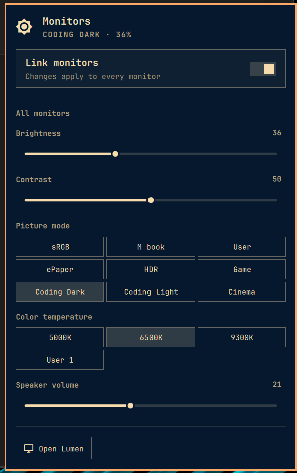

# Lumen for the Omarchy bar

An Omarchy bar widget for external monitors: brightness, contrast, picture
mode, color temperature and volume over DDC/CI, from an icon next to the
Display widget. Scroll the icon to change brightness; click it for the panel.
With two or more monitors, **Link** drives them together.



The panel is keyboard driven: arrows move between rows and adjust values,
Escape closes it. **Open Lumen** launches the full app.

## Requirements

- [lumen](https://github.com/jimjeffers/lumen), the app that talks to the
  monitors. The widget runs `lumen state` and `lumen set`.
- `ddcutil`, and DDC/CI turned on in each monitor's on-screen menu.
- Your user needs access to `/dev/i2c-*` (Omarchy's default setup allows it;
  otherwise add yourself to the `i2c` group).

Monitor-specific picture mode names live in `~/.config/lumen/<model>.conf`;
see the lumen README.

## Install

```sh
omarchy plugin add https://github.com/jimjeffers/omarchy-lumen --enable
```

Then add **Lumen** to the bar from the bar settings if it doesn't appear.

## Settings

| Setting | Default | |
|---|---|---|
| Link monitors when the panel opens | on | Start in linked mode |
| Path to lumen | empty | Leave empty to use `lumen` from `PATH` |

## Remove

```sh
omarchy plugin remove io.github.jimjeffers.lumen
```

## Notes

- English only for now; translations go in `i18n/<code>.json`.
- Tests for the panel logic: `node tests/model.test.js`.

## License

MIT
